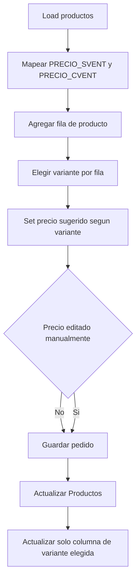

# Soporte de doble precio por producto

## Objetivo
Incorporar dos precios por producto en el flujo de pedidos (`sin ventilador` y `con ventilador`) sin romper la lógica actual de cálculo, guardado ni sincronización con la hoja de `Productos`.

## Alcance

1. Adaptar lectura de catálogo de productos para nuevos headers:
   - Reemplazar dependencia del header `PRECIO` por detección de:
     - `PRECIO S/VENT`
     - `PRECIO C/VENT`
   - Mantener fallback defensivo para evitar roturas si un header falta.
   - Archivo: [/home/blank/Desktop/excel/Pedidos/pedidos.gs](/home/blank/Desktop/excel/Pedidos/pedidos.gs)

2. Incorporar selector por fila en formulario de pedido:
   - En cada producto del pedido, agregar selector de variante:
     - `Sin ventilador`
     - `Con ventilador`
   - Al cambiar la variante, actualizar precio unitario sugerido de esa fila.
   - Mantener edición manual de precio como hoy.
   - Archivo: [/home/blank/Desktop/excel/Pedidos/FormularioPedidos.html](/home/blank/Desktop/excel/Pedidos/FormularioPedidos.html)

3. Persistir variante elegida en payload del pedido:
   - En el objeto enviado desde formulario, incluir por ítem:
     - variante seleccionada (`S/VENT` o `C/VENT`)
     - precio utilizado
   - Mantener el formato actual del detalle del pedido, agregando etiqueta de variante de forma clara.
   - Archivos:
     - [/home/blank/Desktop/excel/Pedidos/FormularioPedidos.html](/home/blank/Desktop/excel/Pedidos/FormularioPedidos.html)
     - [/home/blank/Desktop/excel/Pedidos/pedidos.gs](/home/blank/Desktop/excel/Pedidos/pedidos.gs)

4. Ajustar actualización de precios al catálogo (`Productos`):
   - Modificar `actualizarPreciosProductos(...)` para que, si el usuario editó manualmente el precio en una fila:
     - actualice solo la columna de la variante seleccionada en ese ítem.
   - No tocar la otra columna de precio.
   - Archivo: [/home/blank/Desktop/excel/Pedidos/pedidos.gs](/home/blank/Desktop/excel/Pedidos/pedidos.gs)

## Flujo esperado

## Validación
- Carga inicial de catálogo:
  - cada producto debe traer ambos precios si existen.
- Formulario:
  - cambio de variante por fila actualiza precio sugerido.
  - edición manual sigue recalculando totales.
- Guardado:
  - pedido se guarda correctamente con la variante elegida por ítem.
- Sincronización catálogo:
  - si se modifica precio manualmente en una fila `Sin ventilador`, solo cambia `PRECIO S/VENT`.
  - si se modifica en `Con ventilador`, solo cambia `PRECIO C/VENT`.

## Riesgos y mitigación
- Riesgo: productos sin alguno de los dos headers/precios.
  - Mitigación: fallback a `0` y mensajes defensivos en backend.
- Riesgo: mismatch entre variante seleccionada y columna actualizada.
  - Mitigación: enviar y validar explícitamente campo `variantePrecio` en cada ítem antes de persistir.